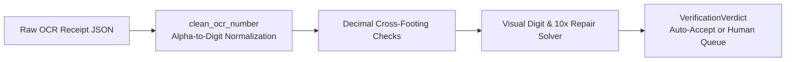

# receipt-guard

[](https://github.com/codesphere-u/receipt-guard/actions/workflows/ci.yml)
[](LICENSE)
[](pyproject.toml)
[](pyproject.toml)

**Deterministic OCR post-processor for thermal receipts, invoices & agro-waybills: exact `Decimal` cross-footing arithmetic verification, OCR digit-confusion repair (`O/0`, `l/1`, `S/5`, `B/8`, 10x shifts), and human-review routing.**

- **Mission Domain:** Document AI & Microfinance Accounting
- **Stack:** Pure Python 3.11+ (zero runtime third-party dependencies, `mypy --strict`, `ruff`, `pytest`)
- **Maintainer:** Codesphere Innovations (U) Limited (`codesphere-u`)

---

## Problem Solved

Vision-language models and Tesseract silently hallucinate digits on faded thermal receipts (turning `UGX 150,000` into `UGX 1,500,000`), corrupting microfinance, SACCO, and cooperative accounting ledgers.

## Key Features

- Exact `Decimal` verification of line-item `qty * unit_price == line_total`, subtotal summation, and `subtotal + tax - discount == grand_total`.
- Automated alpha-to-digit OCR sanitizer (`O/o/Q/D -> 0`, `I/l/| -> 1`, `S -> 5`, `B -> 8`).
- Single-digit visual-confusion and 10x zero-hallucination repair solver (`_find_single_digit_repair`) paired with confidence-gated human review escalation.

## Architecture Overview



See [docs/architecture.md](docs/architecture.md) for module-level design details.

## Installation

```bash
git clone https://github.com/codesphere-u/receipt-guard.git
cd receipt-guard
uv sync --extra dev
```

Or install in editable mode with standard `pip`:

```bash
pip install -e ".[dev]"
```

## Quick Start (CLI)

```bash
receipt-guard demo
```

## Quick Start (Python API)

```python
from receipt_guard import OcrLineItem, OcrReceiptInput, verify_receipt

v = verify_receipt(OcrReceiptInput("R1", "UGX", (OcrLineItem("Seed", "2", "45,OOO", "90,000"),), "90,000", raw_grand_total="90,000"))
assert v.passed
```

## Testing & Quality Gates

```bash
uv run ruff check src tests
uv run mypy src
uv run pytest -v
```

## Security, Contributing & Roadmap

- **Security:** See [SECURITY.md](SECURITY.md) for responsible disclosure procedures.
- **Contributing:** See [CONTRIBUTING.md](CONTRIBUTING.md) and [CODE_OF_CONDUCT.md](CODE_OF_CONDUCT.md).
- **Changelog & Roadmap:** See [CHANGELOG.md](CHANGELOG.md) and [ROADMAP.md](ROADMAP.md).

## License

MIT License — see [LICENSE](LICENSE).

## Support & Contact

Open an issue on [GitHub Issues](https://github.com/codesphere-u/receipt-guard/issues) or contact `codesphereinnovationz@gmail.com`.
